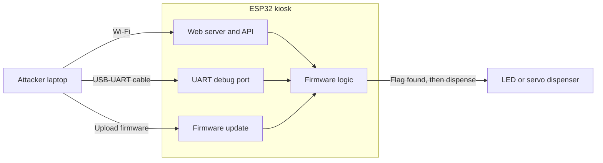

# DVVM Block Diagram

## What each block is
- **Attacker laptop:** the player hacking the machine
- **ESP32 kiosk:** the vending machine's brain
- **Web server and API:** the Wi-Fi side. It holds vulnerabilities 1, 2 and 3.
- **UART debug port:** the cable side. It holds vulnerability 4.
- **Firmware update:** vulnerability 5, the stretch goal
- **LED or servo:** the fake snack dispenser. It lights up or moves when you hack in.
